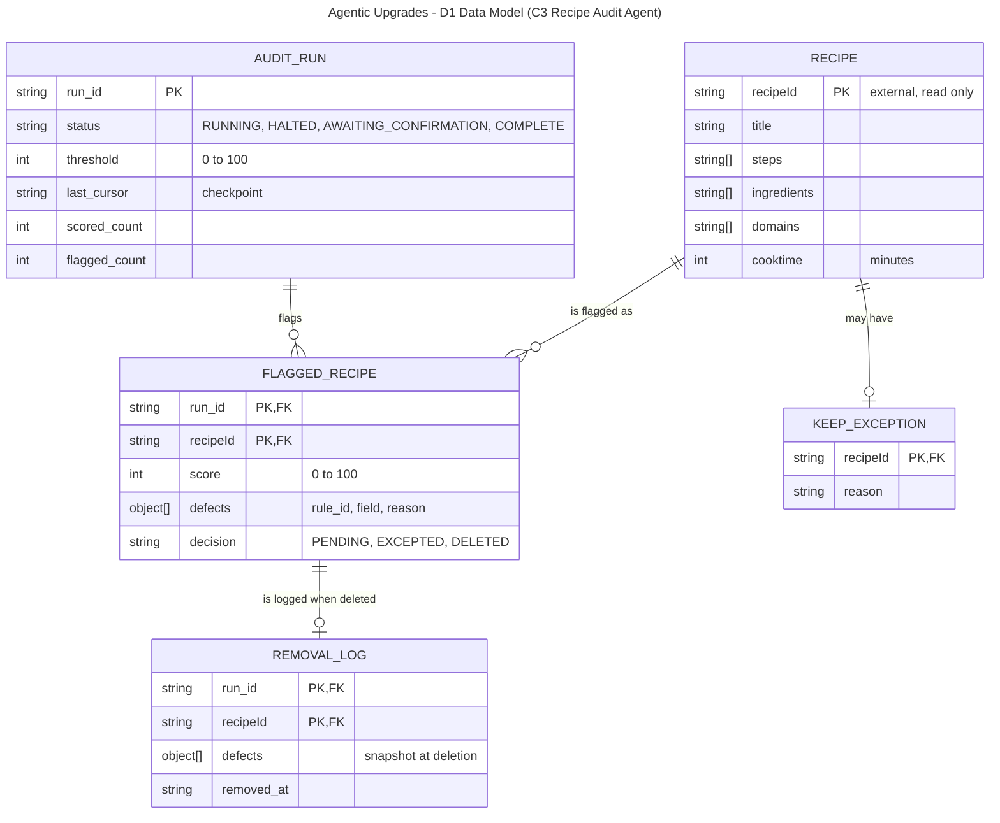

# D1 Detailed Design

**Team:** GE Appliances, a Haier Company
**Team members:** Dan Nassirharand, Maxwell Blevins

---

## 1. Header, Scope, and Conventions

**Project title:** GE Appliances, a Haier Company: Agentic Upgrades

**Goal statement:** Use AI agents to boost developer productivity, enabling the organization to deliver user features of higher quality and quantity.

**Scope:** This document details C3 Recipe Audit Agent and C4 Recipe Quality Scorer from D0; C1 PR Review Agent and C2 Knowledge Base Index are deferred to D2.

**Figure conventions:** Each box is an entity, with attributes listed as `type name`. `PK` marks a primary key and `FK` a foreign key. Each line is a relationship, drawn in crow's-foot notation with cardinality at both ends: `||` exactly one, `o|` zero or one, `o{` zero or many, `|{` one or many. RECIPE belongs to the external Recipe Database; C3 reads and deletes it there but does not store a copy.

**Data size:** about 200,000 recipes, each with an estimated 10 steps and 10 ingredient entries (the per-recipe counts are subject to change). The scoring rules, weights, threshold, and batch size in this document are examples and are subject to change.

---

## 2. Data Model



**Structural decisions**

| Decision | Why | Requirement |
| --- | --- | --- |
| `FLAGGED_RECIPE` is an entity, and only flagged recipes are stored. | A recipe can be flagged in many runs and a run flags many recipes (many-to-many), so this entity splits it into two one-to-many links and holds the per-run score. Passing recipes are only counted on `AUDIT_RUN`. | AC-02.1 |
| Defects, steps, ingredients, and domains are attributes, not entities. | They are always read with their parent and never queried alone. | AC-02.1 |
| `KEEP_EXCEPTION` is one-to-zero-or-one with `RECIPE`, not tied to a run. | An exception must apply to every future run. | UC-02 A2 |
| `REMOVAL_LOG` is a separate record, zero or one per `FLAGGED_RECIPE`. | It must outlive the deleted recipe, and it is written before the delete. | UC-02 postcondition |
| `AUDIT_RUN.last_cursor` is the checkpoint. | A halted run resumes from the last fully scored batch. | AC-02.2 |
| Indexed: `run_id` (partition key) with `recipeId` (sort key) on `FLAGGED_RECIPE` and `REMOVAL_LOG`; `recipeId` on `KEEP_EXCEPTION`; `run_id` on `AUDIT_RUN`. | One query returns a run's flagged recipes, and the exception list is loaded by key. | AC-02.1 |

**Store choice:** A simpler key-value store (Amazon DynamoDB), not relational. Every access is a lookup by key or a query within one partition, with no joins.

---

## 3. Core Algorithms

### Recipe scoring and batch flagging (C4 scorer, C3 audit loop)

**1. What it is and the problem it solves.** Scores each recipe from 0 to 100 and flags those below the threshold for the engineer to confirm for deletion. A wrong score deletes good recipes or keeps bad ones, and a loop that cannot resume loses work (AC-02.1, AC-02.2).

*Scoring (C4).* Start at 100 and subtract penalties; clamp to 0 to 100. The weights and the threshold of 70 are examples and are subject to change. The scorer reads only `steps` and `ingredients`; the other recipe fields are not scored.

| Rule ID | Condition | Penalty |
| --- | --- | --- |
| `INS_MIN_STEPS` | Fewer than 3 non-blank steps | 35 |
| `INS_SHORT_STEP` | Share of steps shorter than 10 characters | 15 x share, rounded |
| `ING_NONE` | No non-blank ingredient entries | 40 |
| `ING_BLANK_ENTRY` | Share of ingredient entries that are blank | 10 x share, rounded |

*Audit loop (C3).* Load the exception list. Starting at `last_cursor`, repeat: read a batch of 500 recipes (batch size subject to change) with a 30-second timeout, skip excepted and duplicate recipes, score each one, write those below the threshold as `FLAGGED_RECIPE` rows, then write the new `last_cursor` and counts to `AUDIT_RUN`. When the cursor is empty, set the status to `AWAITING_CONFIRMATION`. To delete a confirmed recipe, write its `REMOVAL_LOG` row first, then delete it.

**2. Inputs and outputs.**

- `score(recipe, ruleset_version)`: `recipe` is {`recipeId`: string, `title`: string, `steps`: string[], `ingredients`: string[], `domains`: string[], `cooktime`: int minutes}, `ruleset_version` is a string. Returns {`score`: int 0 to 100, `defects`: {`rule_id`: string, `field`: string, `reason`: string}[]}.
- Loop: `threshold`: int 0 to 100 (default 70). Produces `FLAGGED_RECIPE` rows and an `AUDIT_RUN` record.

**3. Expected complexity.** Scoring one recipe is O(S + I) for S steps and I ingredients, about 20 operations, so 200,000 recipes is about 4 million operations, well under a second. At 100 times (20 million recipes) it is about 400 million operations, still seconds. Database reads dominate: 400 batches now and 40,000 at 100 times. Read speed against the 30-second timeout is what to measure first; scoring is not worth tuning.

**4. Why this one rather than the alternatives.**

| Alternative | Why not |
| --- | --- |
| LLM scores each recipe | Not repeatable, costs tokens on every recipe, and hard to test against "below 70". |
| Score everything, then flag at the end | A failure loses all work and cannot resume (AC-02.2). |
| Delete automatically below the threshold | UC-02 requires the engineer to confirm. |

**5. Edge cases.**

| Case | Behavior |
| --- | --- |
| Empty batch | Treated as the last batch. |
| Duplicate `recipeId` in a batch | Scored once. |
| Score equal to the threshold | Not flagged; only scores strictly below are flagged (AC-02.1). |
| Recipe on the exception list | Skipped (UC-02 A2). |
| Missing or wrong-typed `steps` or `ingredients` | Score 0 with defect `UNPARSEABLE`; the run continues. |
| Batch read over 30 seconds or fails | Run set to `HALTED`, `last_cursor` unchanged, nothing more deleted, engineer told the resume point (AC-02.2). |
| Removal log write fails | That recipe is not deleted. |

---

## 4. Build-versus-Reuse Decisions

| Piece | Build or reuse | Library or service | License | Reason |
| --- | --- | --- | --- | --- |
| REST endpoints (C3) | Reuse | Spring Boot (Spring Web) | Apache-2.0 | Mature and well documented; both teammates have used it. |
| Authentication (C3) | Reuse | Spring Security | Apache-2.0 | Authentication is not hand-rolled. |
| DynamoDB access and paging (C3) | Reuse | AWS SDK for Java v2 | Apache-2.0 | Official and maintained; Maxwell has used it. |
| Command-line client (C3) | Reuse | picocli | Apache-2.0 | Mature; replaces hand-written argument parsing. |
| Batch loop, checkpoint, halt and resume (C3) | Build | None | Not applicable | Project-specific logic behind AC-02.2. |
| Removal log and exception list (C3) | Build | None | Not applicable | Small and specific to UC-02. |
| Scoring rules (C4) | Build | None | Not applicable | Domain logic; plain code keeps scores repeatable. |
| Ruleset file loading (C4) | Reuse | Jackson YAML | Apache-2.0 | Standard for Java; ruleset changes without code changes. |

---

## 5. API Contract

All endpoints are HTTPS with JSON and require authentication; a missing or invalid credential gives 401 `UNAUTHENTICATED`.

| Endpoint | Inputs | Outputs | Errors |
| --- | --- | --- | --- |
| `POST /v1/audit-runs` (start) | `threshold`: int, optional, 0 to 100, default 70. | 202: `run_id`: string, `status`: "RUNNING", `threshold`: int. | 400 `INVALID_THRESHOLD`. 409 `RUN_IN_PROGRESS`: only one run at a time. |
| `GET /v1/audit-runs/{run_id}` | `run_id`: string, required. `limit`: int, optional, 1 to 200, default 50. `page_token`: string, optional. | 200: `status`: "RUNNING" \| "HALTED" \| "AWAITING_CONFIRMATION" \| "COMPLETE", `scored_count`: int, `flagged_count`: int, `flagged`: {`recipeId`: string, `score`: int 0 to 100, `defects`: {`rule_id`: string, `field`: string, `reason`: string}[], `decision`: "PENDING" \| "EXCEPTED" \| "DELETED"}[], `next_page_token`: string or null. | 404 `RUN_NOT_FOUND`. 400 `INVALID_LIMIT`. |
| `POST /v1/audit-runs/{run_id}/resume` | `run_id`: string, required. | 202: `status`: "RUNNING". | 404 `RUN_NOT_FOUND`. 409 `RUN_NOT_HALTED`. |
| `POST /v1/audit-runs/{run_id}/exceptions` | `recipeIds`: string[], required, 1 to 200. `reason`: string, required, 1 to 500 characters. | 200: `excepted_ids`: string[]. | 400 `INVALID_REQUEST`. 404 `RUN_NOT_FOUND`. 422 `RECIPE_NOT_FLAGGED`: ID not flagged in this run. |
| `POST /v1/audit-runs/{run_id}/deletions` | `recipeIds`: string[], required, 1 to 200. | 200: `deleted_count`: int, `deleted_ids`: string[]. | 400 `INVALID_REQUEST`. 404 `RUN_NOT_FOUND`. 409 `RUN_NOT_AWAITING_CONFIRMATION`: scoring not finished. 422 `RECIPE_NOT_DELETABLE`: not flagged in this run, or excepted. 503 `LOG_WRITE_FAILED`: removal log not written, so nothing was deleted. |

**Example: confirm deletion of two flagged recipes**

```http
POST /v1/audit-runs/run-20261008-01/deletions
Content-Type: application/json

{ "recipeIds": ["r-10482", "r-20931"] }
```

```http
HTTP/1.1 200 OK
Content-Type: application/json

{ "deleted_count": 2, "deleted_ids": ["r-10482", "r-20931"] }
```

**Versioning:** The major version is in the URL path (`/v1`), and removing or renaming a field, changing a field's type or meaning, or making an optional input required is a breaking change that requires `/v2`, while adding optional inputs, response fields, or endpoints is not.

---

## 6. Technology Choices with Justification

**Database: Amazon DynamoDB.** Maxwell has built backend APIs on DynamoDB and loaded data into it with Python (team skill fit). It is a proprietary AWS service under AWS terms, with the cost of vendor lock-in (licensing). It has extensive documentation and a large user base (community support). Every access in part 2 is a key lookup or single-partition query, which it serves with low latency (performance). On-demand billing is per request and should be small for occasional audits; this needs checking with the AWS pricing calculator (cost and hosting). We passed over PostgreSQL on Amazon RDS: it is open source with a strong community, but nobody on the team has used it professionally, it needs a database server to run, and our data has no joins.

**Backend: Java with Spring Boot.** Maxwell developed Java and Spring Boot APIs across two co-ops, and Dan has built a Spring Boot application, so both can review each other's code (team skill fit). Spring Boot and the AWS SDK are Apache-2.0 and OpenJDK is open source (licensing). It is among the most widely used frameworks, with extensive documentation (community support). The workload is about 4 million operations per audit, comfortably fast on the JVM (performance). The runtime is free and runs in a container (cost and hosting). We passed over Python with FastAPI: both teammates know Python and it is faster to prototype, but the team's existing AWS service work is in Java.

**Front end: command-line client built with picocli.** The interface in D0 (I6) is a command line, and the only user is a cloud-team engineer who works in a terminal. Both teammates know Java, and picocli only adds argument parsing (team skill fit). It is Apache-2.0 (licensing), mature and widely used (community support), and each command makes one HTTP call, so it adds no meaningful delay (performance). It needs no hosting and ships as one file (cost and hosting). We passed over a React web page: it would give a nicer review screen but needs a front-end build, sign-in, and hosting this use case does not justify.

**Hosting: AWS ECS on Fargate, defined with Terraform.** Dan has used AWS and Terraform, so infrastructure can be reviewed as code (team skill fit). Terraform is open source and ECS is covered by standard AWS terms (licensing). Both are widely documented and used (community support). A full audit can run longer than AWS Lambda's 15-minute limit, and a long-running container avoids restarting between batches (performance). Fargate bills for reserved CPU and memory while running; a small task should be inexpensive, to be confirmed with the AWS pricing calculator (cost and hosting). We passed over AWS Lambda for the 15-minute limit, and over our own EC2 servers, which add patching work for no gain.
