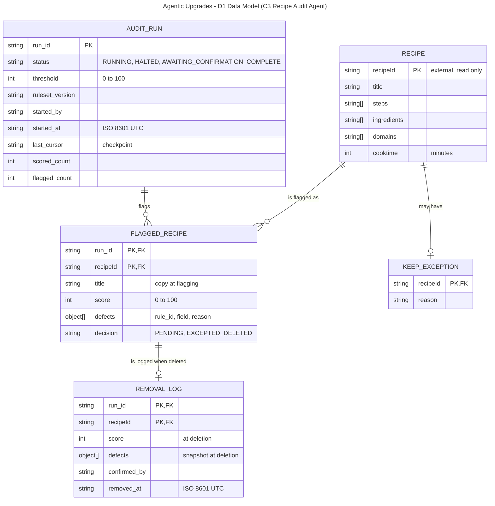

# D1 Detailed Design

**Team:** GE Appliances, a Haier Company
**Team members:** Dan Nassirharand, Maxwell Blevins

---

## 1. Header, Scope, and Conventions

**Project title:** GE Appliances, a Haier Company: Agentic Upgrades

**Goal statement:** Use AI agents to boost developer productivity, enabling the organization to deliver user features of higher quality and quantity.

**Scope:** This document details all four D0 components: C1 PR Review Agent, C2 Knowledge Base Index, C3 Recipe Audit Agent, and C4 Recipe Quality Scorer. C1 and C2 are configuration on GitHub, not a hosted service, so they have no persistent data of their own.

**Figure conventions:** Each box is an entity, with attributes listed as `type name`. `PK` marks a primary key and `FK` a foreign key. Each line is a relationship in crow's-foot notation with cardinality at both ends: `||` exactly one, `o|` zero or one, `o{` zero or many, `|{` one or many. `RECIPE` belongs to the external Recipe Database, a separate DynamoDB table; C3 reads and deletes it there but stores no copy. Foreign keys are logical, since DynamoDB does not enforce them.

**Data size:** about 200,000 recipes. This count, and all scoring rules, weights, thresholds, and batch sizes, are examples and subject to change.

**Deltas from D0** (D0 is unchanged; D1 refines it):

| D0 item                       | D0                                                                                              | D1                                                                                                                                                              | Reason                                                           |
| ----------------------------- | ----------------------------------------------------------------------------------------------- | --------------------------------------------------------------------------------------------------------------------------------------------------------------- | ---------------------------------------------------------------- |
| I6 (Engineer ↔ C3)            | CLI; inputs `start_audit`, `confirm_ids`; output `flagged` with a `reason` string.              | CLI calls C3 over HTTPS REST (part 5), with added resume, exception, and paged status calls. Flagged items carry `title`, `defects` objects, and a `decision`.  | UC-02 A2 and E1; AC-02.1 requires the specific field per defect. |
| I7 (C3 ↔ Recipe DB)           | Inputs `batch_size`, `delete_ids`; records `id`, `instructions`, `ingredients`; "Database SDK". | Adds `cursor`; records use `recipeId` and `steps`, plus `title`, `domains`, `cooktime` (unscored). AWS SDK for Java v2 against DynamoDB.                        | Resume from the checkpoint (AC-02.2); full record shape.         |
| I8 (C3 ↔ C4)                  | Output `defects`: string[].                                                                     | Input adds `ruleset_version`; output `defects`: {`rule_id`, `field`, `reason`}[].                                                                               | Reproducible scores and field-level reasons.                     |
| Audit store                   | Not shown.                                                                                      | New DynamoDB tables for runs, flags, exceptions, and the removal log (part 2); proposed interface I9, C3 ↔ Audit Store.                                         | Checkpoint, exceptions, and removal log (UC-02).                 |
| Deployment and authentication | Not covered.                                                                                    | C3: ECS Fargate behind API Gateway with IAM (SigV4) authorization (part 6). C1 and C2: GitHub configuration, with nothing of ours to host.                      | Authentication is not hand-rolled.                               |
| I1 (GitHub → C1)              | HTTPS webhook.                                                                                  | GitHub's pull request configuration starts C1; no webhook endpoint.                                                                                             | C1 runs on GitHub itself.                                        |
| I2 (C1 ↔ C2)                  | HTTPS.                                                                                          | C2 is a tool available to the Copilot reviewer, which custom instructions direct it to use; no separate service.                                                | C1's normal operation is unchanged.                              |
| I3 (GitHub → C2)              | Sync into an index; on failure keep the last good index.                                        | Articles are fetched from the knowledge base repository on every run; no index is stored (C2 keeps its D0 name). On failure C1 applies the manual review label. | No database is needed; "stale" means unreachable.                |
| I4 (C1 ↔ LLM)                 | LLM Provider.                                                                                   | GitHub Copilot; model chosen after testing.                                                                                                                     | Provider kept inside GitHub.                                     |

---

## 2. Data Model



**Structural decisions**

| Decision                                                                                                                                                     | Why                                                                                                                                                                 | Requirement         |
| ------------------------------------------------------------------------------------------------------------------------------------------------------------ | ------------------------------------------------------------------------------------------------------------------------------------------------------------------- | ------------------- |
| `FLAGGED_RECIPE` is an entity; only flagged recipes are stored.                                                                                              | Runs and recipes are many-to-many; this entity splits that into two one-to-many links and holds the per-run score. Passing recipes are only counted on `AUDIT_RUN`. | AC-02.1             |
| Defects, steps, ingredients, and domains are attributes.                                                                                                     | They are always read with their parent and never queried alone.                                                                                                     | AC-02.1             |
| `KEEP_EXCEPTION` is one-to-zero-or-one with `RECIPE`, not tied to a run. It is the source of truth; `FLAGGED_RECIPE.decision` is a display copy.             | An exception must apply to every future run.                                                                                                                        | UC-02 A2            |
| `REMOVAL_LOG` is a separate record, zero or one per `FLAGGED_RECIPE`.                                                                                        | It must outlive the deleted recipe, and it is written before the delete.                                                                                            | UC-02 postcondition |
| `AUDIT_RUN.last_cursor` is the checkpoint.                                                                                                                   | A halted run resumes from the last fully scored batch.                                                                                                              | AC-02.2             |
| `AUDIT_RUN.ruleset_version` records the ruleset used.                                                                                                        | Weights change, so a run must be reproducible.                                                                                                                      | AC-02.1             |
| Indexed: `run_id` (partition key) with `recipeId` (sort key) on `FLAGGED_RECIPE` and `REMOVAL_LOG`; `recipeId` on `KEEP_EXCEPTION`; `run_id` on `AUDIT_RUN`. | One query returns a run's flagged recipes. The exception list is small and loaded whole at run start.                                                               | AC-02.1             |

**Store choice:** A simpler key-value store (Amazon DynamoDB), not relational, for both the audit tables and the Recipe Database. Every access is a key lookup or a query within one partition, with no joins.

**C1 and C2: no persistent data.** The knowledge base is an external, read-only GitHub repository. Review state (comments, verdict, label) lives on the pull request in GitHub, and review cycle time is derived by the organization's existing measurement.

---

## 3. Core Algorithms

### Recipe scoring and batch flagging (C4 scorer, C3 audit loop)

**1. What it is and the problem it solves.** Scores each recipe from 0 to 100 and flags those below the threshold for the engineer to confirm for deletion. A wrong score deletes good recipes or keeps bad ones, and a loop that cannot resume loses work (AC-02.1, AC-02.2).

_Scoring (C4)._ Start at 100, subtract a penalty for each defect, and clamp to 0 to 100. The rules cover too few or very short instruction steps and missing or blank ingredient entries. Penalties and the threshold (default 70) are examples held in the ruleset file. The scorer reads only `steps` and `ingredients`; `title`, `domains`, and `cooktime` are carried but not scored.

_Audit loop (C3)._ Load the full exception list. Starting at `last_cursor`, repeat: read a batch of recipes with a 30-second timeout, skip excepted and duplicate recipes, score each one, and upsert those below the threshold as `FLAGGED_RECIPE` rows. Then write `last_cursor`, `scored_count`, and `flagged_count` to `AUDIT_RUN` in one write, computed from the previous checkpoint's values rather than incremented. Flag rows are keyed upserts, so re-scoring a batch after a crash changes nothing. When the cursor is empty, set the status to `AWAITING_CONFIRMATION`.

_Confirmation (C3)._ For each confirmed recipe, re-score it and skip it if it no longer scores below the threshold, then write its `REMOVAL_LOG` row, then delete it. When no flagged recipe is `PENDING`, set the status to `COMPLETE`.

**2. Inputs and outputs.**

- `score(recipe, ruleset_version)`: `recipe` is {`recipeId`: string, `title`: string, `steps`: string[], `ingredients`: string[], `domains`: string[], `cooktime`: int minutes}, `ruleset_version` is a string. Returns {`score`: int 0 to 100, `defects`: {`rule_id`: string, `field`: string, `reason`: string}[]}.
- Loop: `threshold`: int 0 to 100 (default 70). Produces `FLAGGED_RECIPE` rows and an `AUDIT_RUN` record that stores the `ruleset_version` used.

**3. Expected complexity.** Scoring one recipe is linear in its steps and ingredients (about 20 operations), so a full audit is a few million operations, well under a second, and still seconds at 100 times the volume. Database calls dominate: about 400 batch reads at the example batch size (40,000 at 100 times), plus flag writes in groups of 25. Measure read speed against the 30-second timeout first; scoring is not worth tuning.

**4. Why this one rather than the alternatives.**

| Alternative                              | Why not                                                                            |
| ---------------------------------------- | ---------------------------------------------------------------------------------- |
| LLM scores each recipe                   | Not repeatable, costs tokens on every recipe, and hard to test against "below 70". |
| Score everything, then flag at the end   | A failure loses all work and cannot resume (AC-02.2).                              |
| Delete automatically below the threshold | UC-02 requires the engineer to confirm.                                            |

**5. Edge cases.**

| Case                                                                     | Behavior                                                                                                      |
| ------------------------------------------------------------------------ | ------------------------------------------------------------------------------------------------------------- |
| Empty batch                                                              | Treated as the last batch.                                                                                    |
| Duplicate `recipeId`                                                     | Scored once within a batch; across batches the flag row is overwritten (same key).                            |
| Score equal to the threshold                                             | Not flagged; only scores strictly below are flagged (AC-02.1).                                                |
| Recipe on the exception list                                             | Skipped (UC-02 A2).                                                                                           |
| Two start requests at once                                               | One succeeds through a conditional write on `AUDIT_RUN`; the other gets 409 `RUN_IN_PROGRESS`.                |
| Missing or wrong-typed `steps` or `ingredients`                          | Score 0 with defect `UNPARSEABLE`; the run continues.                                                         |
| Batch read over 30 seconds or fails, or a flag or checkpoint write fails | Run set to `HALTED`, `last_cursor` unchanged, nothing more deleted, engineer told the resume point (AC-02.2). |
| C3 restarts while a run is `RUNNING`                                     | On startup, any `RUNNING` run is set to `HALTED` (assumes one C3 instance); the engineer resumes it.          |
| Recipe edited after it was flagged                                       | Re-scored at deletion; skipped if it no longer scores below the threshold.                                    |
| Removal log write fails                                                  | That recipe is not deleted.                                                                                   |
| Delete fails after the log write                                         | Recipe is not in `deleted_ids`; the log row stays and a retry overwrites it.                                  |

### Pull request review and article selection (C1 review pass, C2 article selection)

**1. What it is and the problem it solves.** C1 is GitHub Copilot's code review, operating as it normally does, with a knowledge base added through custom instructions and a tool available to the reviewer. C2 selects the knowledge base articles relevant to the changed files, using an agentic workflow that combines path or tag matching, keyword search, and similarity search. Each issue based on the knowledge base cites its article (AC-01.1). Findings with no citation are still posted, marked with a Low or Medium impact and confidence, and do not affect the verdict. The verdict is `approved` when no violations remain, and informational comments can be dismissed with a one-line justification (UC-01 A2). On a new commit GitHub marks comments that no longer apply as `outdated`, and the review runs again. A wrong comment erodes engineer trust, and a slow pass misses the 5-minute limit (AC-01.1).

**2. Inputs and outputs.**

- `select_articles(changed_files)`: `changed_files` is string[]. Returns `articles`: {`id`: string, `text`: string}[].
- Review pass: input is a pull request event {`pr_number`: int, `repo`: string, `head_sha`: string, `event_type`: "opened" or "synchronize"}. Output is `comments`: {`file`: string, `line`: int, `body`: string}[], where each comment has an `article_id`: string, or an `impact` and `confidence` ("Low" or "Medium") when uncited, and a `status`: "approved" or "changes_requested".

**3. Expected complexity.** Cost is dominated by the model call and GitHub calls, not computation. Pull request size and knowledge base size are not yet known, so the first measurement is end-to-end time against the 5-minute limit.

**4. Why this one rather than the alternatives.**

| Alternative                                | Why not                                                 |
| ------------------------------------------ | ------------------------------------------------------- |
| Send the whole knowledge base to the model | Higher token cost and weaker citations (D0 decision 3). |
| Use a single retrieval method              | Each method alone misses cases the others catch.        |
| Review once when the pull request opens    | No final outcome after fixes (D0 decision 5).           |

**5. Edge cases.**

| Case                                                        | Behavior                                                                                              |
| ----------------------------------------------------------- | ----------------------------------------------------------------------------------------------------- |
| Finding without an article citation, or no relevant article | Posted, marked with a Low or Medium impact and confidence.                                            |
| Knowledge base unreachable                                  | Manual review label; author notified within 10 minutes (AC-01.2).                                     |
| Model call times out or fails                               | Retry once, then the manual review label.                                                             |
| Posting the review fails                                    | Retry, then the manual review label.                                                                  |
| New commit after a pass                                     | Comments that no longer apply are marked `outdated` by GitHub, and the new event starts a fresh pass. |
| Other event types                                           | Ignored and logged.                                                                                   |

---

## 4. Build-versus-Reuse Decisions

| Piece                                                        | Build or reuse | Library or service                              | License                                    | Reason                                                                                               |
| ------------------------------------------------------------ | -------------- | ----------------------------------------------- | ------------------------------------------ | ---------------------------------------------------------------------------------------------------- |
| REST endpoints (C3)                                          | Reuse          | Spring Boot (Spring Web)                        | Apache-2.0                                 | Mature and well documented; both teammates have used it.                                             |
| Authentication (C3)                                          | Reuse          | Amazon API Gateway, IAM authorization           | AWS terms                                  | Verifies SigV4 signatures, so authentication is not hand-rolled.                                     |
| DynamoDB access and paging (C3)                              | Reuse          | AWS SDK for Java v2                             | Apache-2.0                                 | Official and maintained; Maxwell has used DynamoDB.                                                  |
| Command-line client (C3)                                     | Reuse          | picocli                                         | Apache-2.0                                 | Mature; replaces hand-written argument parsing.                                                      |
| HTTP calls and request signing (CLI)                         | Reuse          | `java.net.http` (JDK) and the AWS SDK v2 signer | GPLv2 with Classpath Exception; Apache-2.0 | Already available; no extra dependency.                                                              |
| Audit loop, checkpoint, removal log, and exception list (C3) | Build          | None                                            | Not applicable                             | Project-specific logic behind AC-02.2 and UC-02.                                                     |
| Scoring rules (C4)                                           | Build          | None                                            | Not applicable                             | Rules are plain code so scores repeat; penalties, threshold, and version come from the ruleset file. |
| Ruleset file loading (C4)                                    | Reuse          | Jackson YAML                                    | Apache-2.0                                 | Penalties change without code changes.                                                               |
| Unit tests                                                   | Reuse          | JUnit 5                                         | EPL-2.0                                    | Standard for Java; covers the "below 70" boundary.                                                   |
| Pull request trigger and review posting (C1)                 | Reuse          | GitHub pull request configuration and REST API  | GitHub terms                               | Native events, comments, labels, and verdicts; nothing of ours to host.                              |
| Model (C1)                                                   | Reuse          | GitHub Copilot                                  | GitHub terms                               | Reviewer behavior unchanged; model chosen after testing.                                             |
| Knowledge base storage (C2)                                  | Reuse          | GitHub repository                               | GitHub terms                               | Documentation is already migrated there (UC-01).                                                     |
| Article selection workflow (C2)                              | Build          | None                                            | Not applicable                             | Project-specific combination of retrieval methods.                                                   |
| Reviewer knowledge base instructions (C1)                    | Build          | None                                            | Not applicable                             | Project-specific rules that point the reviewer to the knowledge base and its citations (AC-01.1).    |

Each reused library or service was checked for maturity (maintained and widely used), license (permissive or vendor terms), performance (none is on the C3 hot path; the C1 pass is bounded by the 5-minute limit), and fit.

---

## 5. API Contract

All C3 endpoints are HTTPS with JSON. API Gateway requires an AWS IAM (SigV4) signature; an unsigned or unauthorized request is rejected with 403 before it reaches C3. Clients poll `GET /v1/audit-runs/{run_id}` for progress.

| Endpoint                                  | Inputs                                                                                                    | Outputs                                                                                                                                                                                                                                                                                                                                                        | Errors                                                                                                                                                                                                                                            |
| ----------------------------------------- | --------------------------------------------------------------------------------------------------------- | -------------------------------------------------------------------------------------------------------------------------------------------------------------------------------------------------------------------------------------------------------------------------------------------------------------------------------------------------------------- | ------------------------------------------------------------------------------------------------------------------------------------------------------------------------------------------------------------------------------------------------- |
| `POST /v1/audit-runs` (start)             | `threshold`: int, optional, 0 to 100, default 70.                                                         | 202: `run_id`: string, `status`: "RUNNING", `threshold`: int.                                                                                                                                                                                                                                                                                                  | 400 `INVALID_THRESHOLD`. 409 `RUN_IN_PROGRESS`: only one run at a time.                                                                                                                                                                           |
| `GET /v1/audit-runs/{run_id}`             | `run_id`: string, required. `limit`: int, optional, 1 to 200, default 50. `page_token`: string, optional. | 200: `status`: "RUNNING" \| "HALTED" \| "AWAITING_CONFIRMATION" \| "COMPLETE", `scored_count`: int, `flagged_count`: int, `flagged`: {`recipeId`: string, `title`: string, `score`: int 0 to 100, `defects`: {`rule_id`: string, `field`: string, `reason`: string}[], `decision`: "PENDING" \| "EXCEPTED" \| "DELETED"}[], `next_page_token`: string or null. | 404 `RUN_NOT_FOUND`. 400 `INVALID_LIMIT`.                                                                                                                                                                                                         |
| `POST /v1/audit-runs/{run_id}/resume`     | `run_id`: string, required.                                                                               | 202: `status`: "RUNNING".                                                                                                                                                                                                                                                                                                                                      | 404 `RUN_NOT_FOUND`. 409 `RUN_NOT_HALTED`.                                                                                                                                                                                                        |
| `POST /v1/audit-runs/{run_id}/exceptions` | `recipeIds`: string[], required, 1 to 200. `reason`: string, required, 1 to 500 characters.               | 200: `excepted_ids`: string[].                                                                                                                                                                                                                                                                                                                                 | 400 `INVALID_REQUEST`. 404 `RUN_NOT_FOUND`. 422 `RECIPE_NOT_FLAGGED`: ID not flagged in this run.                                                                                                                                                 |
| `POST /v1/audit-runs/{run_id}/deletions`  | `recipeIds`: string[], required, 1 to 200.                                                                | 200: `deleted_count`: int, `deleted_ids`: string[]. IDs not listed were skipped (no longer below the threshold) or failed to delete, and can be retried.                                                                                                                                                                                                       | 400 `INVALID_REQUEST`. 404 `RUN_NOT_FOUND`. 409 `RUN_NOT_AWAITING_CONFIRMATION`: scoring not finished. 422 `RECIPE_NOT_DELETABLE`: not flagged in this run, or excepted. 503 `LOG_WRITE_FAILED`: removal log not written, so nothing was deleted. |

**Example: confirm deletion of two flagged recipes**

```http
POST /v1/audit-runs/run-20261008-01/deletions
Content-Type: application/json

{ "recipeIds": ["r-10482", "r-20931"] }
```

```http
HTTP/1.1 200 OK
Content-Type: application/json

{ "deleted_count": 2, "deleted_ids": ["r-10482", "r-20931"] }
```

**Pull request review interfaces (C1, C2).** These are internal to GitHub's configuration, not endpoints.

| Interface                        | Inputs                                                                                                                     | Outputs                                       | Errors                                                                                  |
| -------------------------------- | -------------------------------------------------------------------------------------------------------------------------- | --------------------------------------------- | --------------------------------------------------------------------------------------- |
| I1: pull request event starts C1 | `pr_number`: int, `repo`: string, `head_sha`: string, `event_type`: "opened" \| "synchronize".                             | none                                          | Other event types are ignored and logged.                                               |
| I2: `select_articles` (C1 → C2)  | `changed_files`: string[].                                                                                                 | `articles`: {`id`: string, `text`: string}[]. | Knowledge base unreachable: C1 applies the manual review label and notifies the author. |
| I5: post review (C1 → GitHub)    | `comments`: {`file`: string, `line`: int, `body`: string}[], `label`: string, `status`: "approved" \| "changes_requested". | `review_id`: int                              | Post fails: retry, then the manual review label.                                        |

**Versioning:** The major version is in the URL path (`/v1`), and removing or renaming a field, changing a field's type or meaning, or making an optional input required is a breaking change that requires `/v2`, while adding optional inputs, response fields, or endpoints is not. The configuration interfaces are versioned with the configuration files in the repository.

---

## 6. Technology Choices with Justification

**Database: Amazon DynamoDB.** The team has built backend APIs on DynamoDB and loaded data into it with Python (team skill fit). It is a proprietary AWS service under AWS terms, so it brings vendor lock-in (licensing). It has extensive documentation and a large user base (community support). The Recipe Database is already DynamoDB, and every access in part 2 is a key lookup or single-partition query, which it serves with low latency (performance). On-demand billing is per request and should be small for occasional audits; to be checked with the AWS pricing calculator (cost and hosting). We passed over PostgreSQL on Amazon RDS: it is open source with a strong community, but nobody on the team has used it professionally, it needs a database server, and our data has no joins.

**Backend: Java with Spring Boot.** Maxwell developed Java and Spring Boot APIs across two co-ops, and Dan has built a Spring Boot application, so both can review each other's code (team skill fit). Spring Boot and the AWS SDK are Apache-2.0 and OpenJDK is open source (licensing). It is among the most widely used frameworks, with extensive documentation (community support). The workload is light, a few million operations per audit, and comfortably fast on the JVM (performance). The runtime is free and runs in a container (cost and hosting). We passed over Python with FastAPI: both teammates know Python and it is faster to prototype, but the team's existing AWS service work is in Java.

**Front end: command-line client built with picocli.** The interface in D0 (I6) is a command line, and the only user is a cloud-team engineer who works in a terminal. Both teammates know Java, and picocli only adds argument parsing (team skill fit). It is Apache-2.0 (licensing), mature and widely used (community support), and each command makes one HTTP call, so it adds no meaningful delay (performance). It needs no hosting and ships as one file (cost and hosting). We passed over a React web page: a nicer review screen, but it needs a front-end build, sign-in, and hosting this use case does not justify.

**Hosting (C3): AWS ECS on Fargate behind API Gateway, defined with Terraform.** The team has used AWS and Terraform, so infrastructure can be reviewed as code (team skill fit). Terraform is open source, and ECS and API Gateway fall under standard AWS terms (licensing). All three are widely documented and used (community support). Audit duration is not yet measured and could exceed AWS Lambda's 15-minute limit; a long-running container avoids splitting a run across invocations, and the checkpoint lets a restarted task resume (performance). API Gateway's 29-second limit is fine because starting and resuming a run return 202 immediately. Fargate bills for reserved CPU and memory while running and API Gateway per request; both should be small, to be confirmed with the AWS pricing calculator (cost and hosting). We passed over AWS Lambda for the unmeasured duration risk, and over our own EC2 servers, which add patching work for no gain.

**Pull request review runtime (C1, C2): GitHub.** The team works with GitHub and has reported productivity metrics from it (team skill fit). It falls under GitHub's terms, and the configuration lives in our repository (licensing). It is widely used and well documented (community support). It reacts to pull request events directly, and each pass has a 5-minute budget to be measured (performance). Usage is billed under the organization's overall plan, and there is nothing of ours to host (cost and hosting). We passed over running C1 and C2 as our own service on AWS: it would need an event endpoint, signature checks, and hosting for no gain.

**Model (C1): GitHub Copilot.** The team has used GitHub Copilot for productivity reporting (team skill fit). It is a subscription under GitHub's terms (licensing), widely used with extensive documentation (community support). The specific model is chosen after testing for review quality and time (performance). Billing is under the organization's overall plan, with no separate hosting (cost and hosting).
