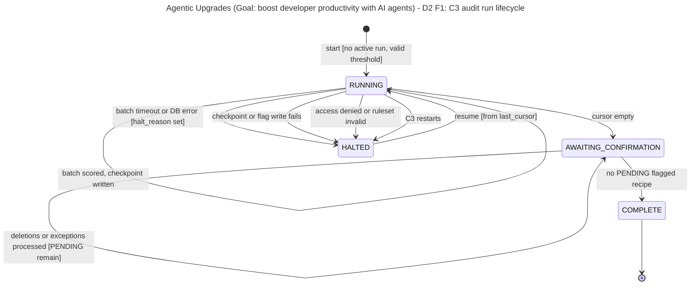
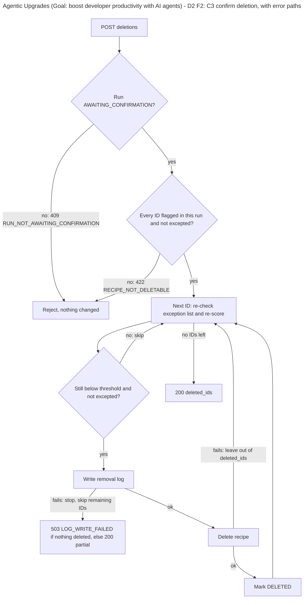
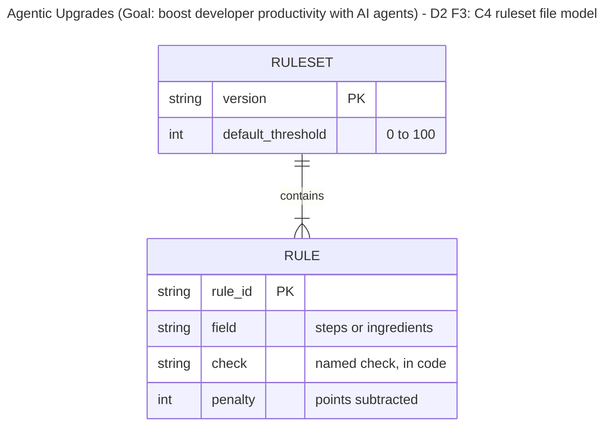
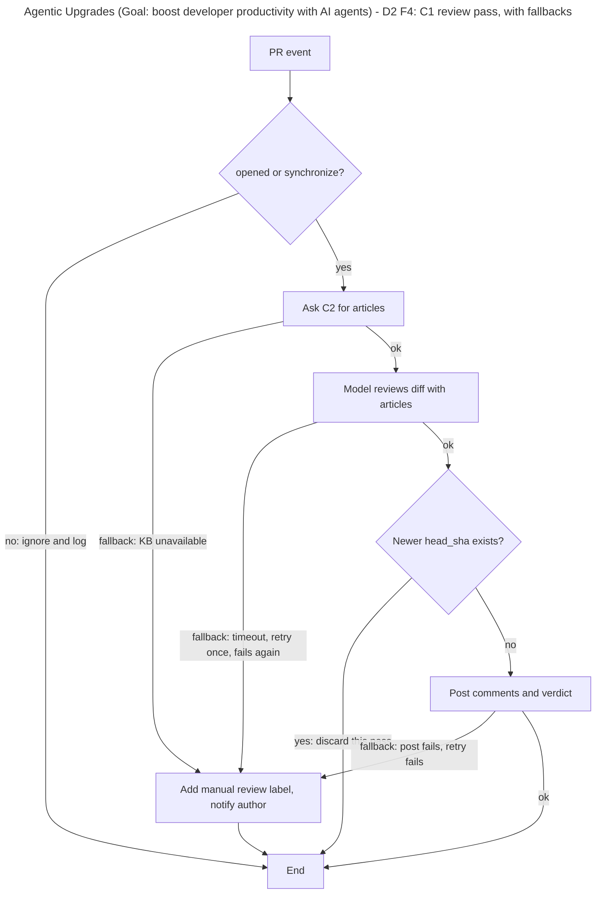
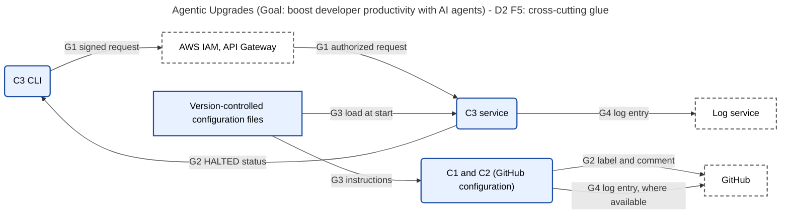

# D2 Detailed Design

**Team:** GE Appliances, a Haier Company
**Team members:** Dan Nassirharand, Maxwell Blevins

---

## 1. Header, Conventions, and D2 Overview

**Project title:** GE Appliances, a Haier Company: Agentic Upgrades

**Goal statement:** Use AI agents to boost developer productivity, enabling the organization to deliver user features of higher quality and quantity.

**Figure conventions** (every figure carries the title and goal in its heading):

| Figure | Type                | Boxes mean                                      | Lines mean                                                                              |
| ------ | ------------------- | ----------------------------------------------- | --------------------------------------------------------------------------------------- |
| F1     | State diagram       | A state of a C3 audit run.                      | A transition, labeled `event [condition]`. Transitions to `HALTED` are the error paths. |
| F2     | Flowchart           | A step (rectangle) or a decision (diamond).     | Order of steps. Red-labeled exits are error paths and name the returned error code.     |
| F3     | Entity-relationship | An entity with `type name` attributes.          | A relationship; `\|\|` exactly one, `o{` zero or many, `\|{` one or many (crow's foot). |
| F4     | Flowchart           | A step or a decision in the C1 review pass.     | Order of steps. Exits labeled `fallback` are error paths.                               |
| F5     | Flowchart           | Solid: we build or configure. Dashed: external. | Cross-cutting use of a glue component, labeled with its ID (G1 to G4).                  |

**Overview for a reviewer with no context.** The system is two AI agents for a cloud engineering team. C1 and C2 add knowledge-base-backed comments to pull requests on GitHub. C3 and C4 audit a recipe database, flag low-quality recipes, and delete only the ones an engineer confirms. D0 gave the block diagram, interfaces, and decision log. D1 gave the C3 data model, the scoring and review algorithms, the C3 API, and technology choices. D2 finishes what D1 left open: the C3 run lifecycle, the command-line client, the scorer's ruleset, the C1 review pass, and the glue (authentication, notifications, configuration, logging). It also adds edge cases, a traceability table, a design rationale, and the peer review notes. D0 and D1 are unchanged.

**Known gaps and open questions**

| ID  | Gap or question                                                                                     | Plan                                                    |
| --- | --------------------------------------------------------------------------------------------------- | ------------------------------------------------------- |
| Q1  | Whether the Copilot reviewer reliably calls C2 and finishes within 5 minutes is unmeasured.         | First measurement task next week.                       |
| Q2  | There is no way to remove a keep exception once added (UC-02 A2 only adds one).                     | Out of scope; no requirement behind it.                 |
| Q3  | C3 has no push notification; a halted run is seen on the next status call.                          | Accepted (rationale R9); revisit if the engineers ask.  |
| Q4  | Recipes added to the database after the cursor has passed are scored on the next run, not this one. | Accepted; the audit is a point-in-time sweep.           |
| Q5  | Where C1's "ignored event" log entries live depends on how GitHub starts C1.                        | Decide when the C1 trigger is built.                    |
| Q6  | D1's status response omitted the halt reason and resume point that UC-02 E1 requires.               | Closed in part 2 (additive change).                     |
| Q7  | Peer review has not been held; parts 3 to 5 may change after it.                                    | Feedback is tracked in part 6 and Peer_Review_Notes.md. |
| Q8  | All thresholds, caps, limits, and defaults are examples and subject to change.                      | Held in configuration (G3), not code.                   |

---

## 2. Finished Components, the D2 Diagrams

### 2.1 C3 Recipe Audit Agent: run lifecycle

**Data model.** The D1 data model (D1 part 2) is unchanged, with one added attribute: `AUDIT_RUN.halt_reason` (string, empty unless `HALTED`): `BATCH_TIMEOUT`, `DB_ERROR`, `STORE_ERROR`, `ACCESS_DENIED`, `CONFIG`, or `RESTART`.

**Behavior: state machine.**

**Behavior: confirmation step list.** Deletion is the destructive path and is shown with its error exits.

**Interface.** The D1 endpoints (D1 part 5) are unchanged except:

| Change                                 | Detail                                                                                                                    |
| -------------------------------------- | ------------------------------------------------------------------------------------------------------------------------- |
| `GET /v1/audit-runs/{run_id}` response | Adds `halt_reason`: string or null, and `resume_point`: string or null (the checkpoint cursor, shown only when `HALTED`). |
| `GET /v1/audit-runs/{run_id}` errors   | Adds 503 `STORE_UNAVAILABLE`.                                                                                             |
| `POST .../deletions` partial failure   | A log write failure stops the loop. 200 with the IDs deleted so far; 503 `LOG_WRITE_FAILED` only if none were deleted.    |

### 2.2 C3 command-line client

**Data model:** no persistent data. The service URL comes from configuration (G3) and credentials from the standard AWS credential chain (G1).

**Behavior: step list.** Every command validates arguments, signs and sends one request, and prints the result.

| Command                                      | Steps                                                                                                                                                                                         |
| -------------------------------------------- | --------------------------------------------------------------------------------------------------------------------------------------------------------------------------------------------- |
| `audit start [--threshold N]`                | Validate the threshold; call start; print `run_id`.                                                                                                                                           |
| `audit status RUN_ID`                        | Call status; follow page tokens until the list ends; print counts, flagged recipes with defects, and, if halted, the reason and resume point.                                                 |
| `audit resume RUN_ID`                        | Call resume; print the new status.                                                                                                                                                            |
| `audit except RUN_ID --ids ... --reason ...` | Split IDs into groups of at most 200; call exceptions per group; print excepted IDs.                                                                                                          |
| `audit delete RUN_ID --ids ...`              | Print the count and ask the engineer to type `yes`; on anything else abort with no call. Split into groups of 200; call deletions per group; print the count deleted and the IDs not deleted. |

**Interface (revises D0 I6).** One command group `audit` with the verbs above. Page tokens and request groups are hidden from the engineer.

| Exit code | Meaning                                                                            |
| --------- | ---------------------------------------------------------------------------------- |
| 0         | Success.                                                                           |
| 2         | Invalid arguments; nothing sent.                                                   |
| 3         | Rejected by C3 (4xx); the error code and message are printed.                      |
| 4         | Service or authentication failure (403, 5xx, no response); no changes are assumed. |

### 2.3 C4 Recipe Quality Scorer

**Data model.** The scorer's only data is the version-controlled ruleset file, with no stored records.

**Behavior: step list.** (1) Load and validate the ruleset at startup. (2) For a recipe, select the ruleset matching `ruleset_version`. (3) Run each rule's check against its field and collect a defect for each failure. (4) Score is 100 minus the sum of penalties, clamped to 0 to 100. (5) A missing or wrong-typed field yields score 0 with defect `UNPARSEABLE`.

**Interface (revises D0 I8).** `score(recipeId, steps, ingredients, ruleset_version)` returns {`score`, `defects`: {`rule_id`, `field`, `reason`}[]}. Error: `UNKNOWN_RULESET` if the version is not loaded; C3 halts the run with `halt_reason` `CONFIG`.

### 2.4 C1 PR Review Agent

**Data model:** no persistent data (D1 part 2). Review state lives on the pull request.

**Behavior: review pass.**

**Interface:** I1, I2, and I5 are unchanged from D1 part 5.

### 2.5 C2 Knowledge Base Index

**Data model:** no persistent data (D1 part 2).

**Behavior: step list.** (1) Take the changed file list. (2) Select candidate articles by path or tag, keyword, and similarity. (3) Merge, remove duplicates, and keep the most relevant up to a configured cap. (4) Return `id` and `text` per article. An empty list is a valid result.

**Interface:** `select_articles(changed_files)` as in D1 part 5. Errors: `KB_UNAVAILABLE`, handled by C1 (F4).

### 2.6 Glue components

| Glue              | Data model                                                                                                                                                  | Behavior                                                                                                                                                                                                                                                                           | Interface and errors                                                                                                                                |
| ----------------- | ----------------------------------------------------------------------------------------------------------------------------------------------------------- | ---------------------------------------------------------------------------------------------------------------------------------------------------------------------------------------------------------------------------------------------------------------------------------- | --------------------------------------------------------------------------------------------------------------------------------------------------- |
| G1 Authentication | No persistent data. Credentials come from the standard AWS credential chain.                                                                                | (1) CLI signs each request. (2) API Gateway verifies it and checks the caller's IAM permission. (3) C3 runs under its own task role limited to the recipe and audit tables. (4) C1 and C2 use GitHub-managed permissions: read code and knowledge base, write comments and labels. | 403 `FORBIDDEN` from the gateway; the request never reaches C3. A DynamoDB access-denied error halts the run (`ACCESS_DENIED`).                     |
| G2 Notifications  | No persistent data. State lives on the pull request (C1) and in `AUDIT_RUN` (C3).                                                                           | C1: apply the manual review label and post a comment mentioning the author within 10 minutes. C3: set `HALTED` with `halt_reason`; the CLI shows it on the next status call.                                                                                                       | Label text "knowledge base unavailable - manual review required". Status fields `halt_reason` and `resume_point`. Failure to post: retry, then log. |
| G3 Configuration  | Files in the repository: the ruleset (F3), service settings (threshold default, batch size, timeout, article cap, service URL), and C1 custom instructions. | Loaded and validated at start. Invalid configuration stops the start; the previous healthy deployment keeps running. A ruleset is pinned to a run at start.                                                                                                                        | `CONFIG_INVALID` at startup names the key. No runtime interface.                                                                                    |
| G4 Logging        | A structured entry: `timestamp`, `component`, `level`, `event`, `correlation_id` (`run_id` or `pr_number`), `error_code`. No recipe content or credentials. | Each component writes one entry per notable event and error. Distinct from `REMOVAL_LOG`, which is the business record and blocks deletion if it cannot be written.                                                                                                                | `log(event, level, correlation_id, error_code)`. A logging failure never fails the caller.                                                          |

### 2.7 Revisions to D0 interfaces

| D0 interface        | Problem                                                                        | D2 revision                                                                                                                                     |
| ------------------- | ------------------------------------------------------------------------------ | ----------------------------------------------------------------------------------------------------------------------------------------------- |
| I6 Engineer ↔ C3    | Grew to five endpoints with paging tokens and request limits visible to users. | One `audit` command group with five verbs; paging and grouping hidden by the CLI (2.2).                                                         |
| I7 C3 ↔ Recipe DB   | `batch_size` passed on every call.                                             | Inputs are `cursor` and `delete_ids`; batch size and timeout come from configuration (G3). Output adds `next_cursor`.                           |
| I8 C3 ↔ C4          | D1 passed unscored fields (`title`, `domains`, `cooktime`) to the scorer.      | Inputs are `recipeId`, `steps`, `ingredients`, `ruleset_version` only (2.3).                                                                    |
| I9 C3 ↔ Audit Store | Proposed in D1, unspecified.                                                   | Operations: start run (conditional write), write checkpoint, upsert flags, load exceptions, write removal log. Errors surface as `STORE_ERROR`. |

---

## 3. Edge Cases and Error Handling

Behavior key: **Retry**, **Degrade**, **Fall back**, **Surface** (report an error, take no action). Error paths are shown in F1, F2, and F4.

| ID    | Component  | Category  | Edge case                                                                  | Design decision                                                                                     | Handler                      | Recoverable                                    |
| ----- | ---------- | --------- | -------------------------------------------------------------------------- | --------------------------------------------------------------------------------------------------- | ---------------------------- | ---------------------------------------------- |
| EC-01 | C1         | Boundary  | Very large diff or many changed files.                                     | Degrade: review up to a configured limit, note the rest was not reviewed; no approval.              | C1 review pass               | Yes; author splits the PR.                     |
| EC-02 | C1         | Timing    | A new push arrives while a pass is running.                                | Fall back: discard the older pass; review the latest `head_sha` only.                               | C1 review pass               | Yes; automatic.                                |
| EC-03 | C1         | Timing    | The pass exceeds 5 minutes.                                                | Degrade: post late, and log the overrun.                                                            | C1 review pass, G4           | Yes; comments still arrive.                    |
| EC-04 | C1         | Bad input | Unsupported event type, or a PR of only unreviewable files.                | Surface: ignore and log the event; for unreviewable files, label for manual review.                 | C1 event filter              | Yes; manual review.                            |
| EC-05 | C1         | External  | Knowledge base, model, or GitHub post fails, or the model is rate limited. | Fall back: retry once (post: retry), then the manual review label and author notice.                | C1 fallback (F4)             | Yes; the next push re-runs.                    |
| EC-06 | C2         | Boundary  | No article matches, or matches exceed the cap.                             | Degrade: none gives uncited findings only (D1); too many keeps the most relevant to the cap.        | C2 article selection         | Yes; automatic.                                |
| EC-07 | C2         | Timing    | An article is edited while a pass runs.                                    | Degrade: use the content read at pass start; the next pass sees the change.                         | C2 article selection         | Yes; automatic.                                |
| EC-08 | C2         | Bad input | Empty file list, or an article missing its ID or text.                     | Degrade: return no articles for an empty list; skip and log a malformed article.                    | C2 article selection, G4     | Yes; fix the article.                          |
| EC-09 | C2         | External  | Knowledge base repository unreachable or partly fetched.                   | Fall back: return `KB_UNAVAILABLE`; no partial results are used.                                    | C1 fallback (F4)             | Yes; the next push re-runs.                    |
| EC-10 | C3         | Boundary  | Threshold 0 or 100, or out of range; zero recipes; 100 times the volume.   | Surface out-of-range; 0 flags nothing; large runs use paged status.                                 | C3 request validation        | Yes; correct the input.                        |
| EC-11 | C3         | Boundary  | More than 200 IDs to delete or except.                                     | Degrade: the CLI sends groups of 200; the API rejects larger requests.                              | CLI, C3 request validation   | Yes; automatic.                                |
| EC-12 | C3         | Timing    | Two start requests at once.                                                | Surface: one succeeds; the other is rejected (D1).                                                  | C3 conditional write         | Yes; wait for the run.                         |
| EC-13 | C3         | Timing    | C3 restarts while a run is `RUNNING`.                                      | Fall back: startup sets it `HALTED` (`RESTART`); the engineer resumes.                              | C3 startup recovery          | Yes; resume.                                   |
| EC-14 | C3         | Timing    | Recipe edited or an exception added between flagging and deletion.         | Fall back: re-check the exception list and re-score before each delete; skip if no longer eligible. | C3 deletion step (F2)        | Yes; skipped IDs can be re-flagged.            |
| EC-15 | C3         | Bad input | Unknown run or recipe ID, duplicates, or malformed request.                | Surface: reject the request; duplicates are removed; nothing is deleted on error.                   | C3 request validation        | Yes; correct the input.                        |
| EC-16 | C3         | Bad input | Engineer declines the CLI confirmation, or uses a wrong `RUN_ID`.          | Surface: the CLI aborts with no call; a wrong ID is rejected.                                       | CLI                          | Yes; re-run the command.                       |
| EC-17 | C3         | External  | Recipe database batch times out, is throttled, or fails.                   | Fall back: `HALTED` with the resume point; no further deletions (D1, AC-02.2).                      | C3 audit loop (F1)           | Yes; resume.                                   |
| EC-18 | C3         | External  | Audit store unavailable.                                                   | Fall back: halt a running audit (`STORE_ERROR`); refuse deletion.                                   | C3 audit loop, deletion step | Yes; resume or retry.                          |
| EC-19 | C3         | External  | CLI cannot reach C3 (gateway error, no response).                          | Retry: status calls twice with backoff; never auto-retry changes; exit 4 and the engineer re-runs.  | CLI error mapper             | Yes; calls are safe to repeat (D1).            |
| EC-20 | C4         | Boundary  | Penalties push the score below 0 or above 100, or equal the threshold.     | Degrade: clamp to 0 to 100; only strictly below the threshold is flagged (D1).                      | C4 scoring                   | Yes; automatic.                                |
| EC-21 | C4         | Timing    | The ruleset file changes during a run.                                     | Degrade: the version is pinned to the run; changes apply to the next run.                           | C4, G3                       | Yes; automatic.                                |
| EC-22 | C4         | Bad input | Missing or wrong-typed `steps` or `ingredients`.                           | Degrade: score 0 with `UNPARSEABLE`; the run continues (D1).                                        | C4 scoring                   | Yes; engineer reviews the flag.                |
| EC-23 | C4         | External  | Ruleset file missing or invalid; unknown version requested.                | Surface: no silent defaults; the run does not start, or halts with `CONFIG`.                        | C4 ruleset loader            | Yes; fix the file and redeploy.                |
| EC-24 | G1 Auth    | Boundary  | Credentials expire between signing and arrival.                            | Retry: the CLI re-signs with fresh credentials once, then exit 4.                                   | CLI error mapper             | Yes; refresh credentials.                      |
| EC-25 | G1 Auth    | Timing    | An engineer's credentials expire during a long run.                        | Degrade: the run uses C3's task role, so it continues; only new calls need credentials.             | C3 task role                 | Yes; no action.                                |
| EC-26 | G1 Auth    | Bad input | Unsigned, invalid, or unauthorized caller.                                 | Surface: 403 at the gateway; logged; never reaches C3.                                              | API Gateway                  | Yes; after access is granted.                  |
| EC-27 | G1 Auth    | External  | IAM or gateway outage; task role lacks a permission.                       | Surface: exit 4; a mid-run access error halts the run (`ACCESS_DENIED`); no retry on denial.        | CLI error mapper, audit loop | Yes; fix permission, then resume.              |
| EC-28 | G2 Notify  | Boundary  | The same PR falls back on many pushes.                                     | Degrade: apply the label once and one comment per `head_sha`.                                       | C1 fallback                  | Yes; automatic.                                |
| EC-29 | G2 Notify  | Timing    | A notice would pass 10 minutes, or a halted run is never checked.          | Degrade: the label or status stays the source of truth; log the fallback time.                      | C1 fallback, G4              | Yes; the state stays visible.                  |
| EC-30 | G2 Notify  | Bad input | Author cannot be mentioned (bot or removed account).                       | Fall back: label still applied; comment mentions a configured fallback team.                        | C1 fallback, G3              | Yes; automatic.                                |
| EC-31 | G2 Notify  | External  | GitHub rejects the label or comment.                                       | Retry: up to three times with backoff, then log an error; no other channel.                         | C1 fallback, G4              | Partly; found through logs.                    |
| EC-32 | G3 Config  | Boundary  | A setting is out of its allowed range (batch size 0, negative timeout).    | Surface: startup validation rejects it.                                                             | G3 loader                    | Yes; fix the file.                             |
| EC-33 | G3 Config  | Timing    | Configuration changes while a run is in progress.                          | Degrade: loaded at start; changes apply on the next start or run.                                   | G3 loader                    | Yes; automatic.                                |
| EC-34 | G3 Config  | Bad input | Malformed file, unknown key, or missing required key.                      | Fall back: stop the new start with `CONFIG_INVALID`; the healthy deployment keeps running.          | G3 loader                    | Yes; fix the file.                             |
| EC-35 | G3 Config  | External  | The C1 instructions file is missing from the repository.                   | Surface: a repository check fails the change; otherwise C1 gives uncited findings only (D1).        | Repository check             | Yes; restore the file.                         |
| EC-36 | G4 Logging | Boundary  | A field would be too long or contain recipe text.                          | Degrade: log IDs only; truncate fields.                                                             | G4 writer                    | Yes; automatic.                                |
| EC-37 | G4 Logging | Timing    | Repeated failures produce a flood of identical entries.                    | Degrade: log the first, then a periodic count.                                                      | G4 writer                    | Yes; automatic.                                |
| EC-38 | G4 Logging | Bad input | Missing correlation ID, or a credential in a message.                      | Degrade: allowlist of fields; anything else is dropped.                                             | G4 writer                    | Yes; automatic.                                |
| EC-39 | G4 Logging | External  | The log service is unavailable.                                            | Degrade: never block the caller; write to local output and move on. `REMOVAL_LOG` is unaffected.    | G4 writer                    | Partly; entries during the outage may be lost. |

---

## 4. Requirements Traceability Table

Priority: Must, Should, Could. IDs are assigned here: FR-01 to FR-06 trace to UC-01, FR-07 to FR-13 to UC-02, NFR-01 to NFR-03 to the AC items, NFR-04 to NFR-06 to the Week 3 constraints essay, and NFR-07 to NFR-09 to D1.

| ID and requirement                                                                                 | Priority | Design elements                                                                      | How satisfied                                                                                                               |
| -------------------------------------------------------------------------------------------------- | -------- | ------------------------------------------------------------------------------------ | --------------------------------------------------------------------------------------------------------------------------- |
| FR-01: Retrieve the knowledge base articles relevant to the changed files.                         | Must     | `select_articles` (D1 part 5, I2); C2 step list (2.5)                                | Path, keyword, and similarity selection, capped and ranked.                                                                 |
| FR-02: Post inline comments, each citing its article.                                              | Must     | `comments.article_id` (I5); F4                                                       | Each knowledge-base finding carries an article ID; uncited findings are marked Low or Medium (D1).                          |
| FR-03: Re-review on each push and approve when no violations remain.                               | Must     | `event_type` "synchronize" (I1); F4; EC-02                                           | Each push starts a pass on the latest `head_sha`; `status` "approved" is set when clean.                                    |
| FR-04: Informational comments can be dismissed with a one-line justification.                      | Should   | GitHub review comment resolution (I5)                                                | Uses GitHub's native resolve; nothing of ours to build. Gap: none beyond this.                                              |
| FR-05: When the knowledge base is unavailable, label the PR and notify the author.                 | Must     | F4 fallback; G2 label text; EC-05, EC-09                                             | Fallback path applies the label and mentions the author.                                                                    |
| FR-06: Record a pass/fail outcome with citations, and review cycle time.                           | Should   | `status` and comments on the PR (I5)                                                 | Outcome lives on the PR. Cycle time is derived by the organization's existing measurement, not by C1 (explained gap).       |
| FR-07: Engineer starts an audit that scores recipes in batches.                                    | Must     | `POST /v1/audit-runs`; `AUDIT_RUN`; `audit start` (2.2); F1                          | Start creates a run; the audit loop reads and scores batches.                                                               |
| FR-08: Flag recipes below the threshold with the specific field.                                   | Must     | `FLAGGED_RECIPE.defects`; `score()` (2.3)                                            | Each defect carries `rule_id`, `field`, and `reason`.                                                                       |
| FR-09: Engineer reviews flagged recipes with the justification.                                    | Must     | `GET /v1/audit-runs/{run_id}`; `audit status` (2.2)                                  | Paged status lists each flagged recipe with its defects.                                                                    |
| FR-10: Confirm deletion; report the count removed.                                                 | Must     | `POST .../deletions`; `deleted_count`; F2; `audit delete` (2.2)                      | Only confirmed IDs are deleted; the count is returned.                                                                      |
| FR-11: Recipes marked as keep exceptions are excluded from later runs.                             | Should   | `KEEP_EXCEPTION`; `POST .../exceptions`; EC-14                                       | Exception list is loaded at each run start and re-checked before each delete. Gap: no removal (Q2).                         |
| FR-12: On a database timeout or failure, halt, checkpoint, and tell the engineer the resume point. | Must     | `AUDIT_RUN.last_cursor`, `halt_reason`, `resume_point`; F1; `POST .../resume`; EC-17 | Halt keeps the cursor; status shows the resume point; resume continues from it.                                             |
| FR-13: Keep a log of removed record IDs and the reason for each.                                   | Must     | `REMOVAL_LOG`; F2                                                                    | Written before each delete; the delete is skipped if the write fails.                                                       |
| NFR-01: Comments posted within 5 minutes of PR creation (AC-01.1).                                 | Must     | F4; EC-03; G4                                                                        | Pass is bounded and the overrun is logged. Gap: the Copilot pass time is unmeasured (Q1).                                   |
| NFR-02: Author notified within 10 minutes when the knowledge base fails (AC-01.2).                 | Must     | G2; EC-29                                                                            | The fallback runs inside the pass; the time is logged. Gap: GitHub notification delivery is not ours to control.            |
| NFR-03: Database batch query times out at 30 seconds (AC-02.2).                                    | Must     | I7 timeout setting (G3); F1; EC-17                                                   | Timeout is a configured setting that triggers the halt path.                                                                |
| NFR-04: Security: least privilege, authenticated access, human confirmation before deletion.       | Must     | G1; API Gateway IAM; C3 task role; `audit delete` prompt; F2                         | Callers are authenticated; C3 holds only the permissions it needs; deletion needs a confirmation at the CLI and at the API. |
| NFR-05: Security: code is reviewed and tested in an isolated environment.                          | Should   | Terraform-defined stacks (D1 part 6)                                                 | Gap: the non-production stack and a sandbox repository for C1 are not yet specified; they become tasks next week.           |
| NFR-06: Cost: limit token and subscription spend.                                                  | Should   | Article cap (G3); fixed-rule scoring (D0 decision 2); on-demand storage              | Only relevant articles reach the model; no model call per recipe. Gap: costs are not yet measured.                          |
| NFR-07: Scores are repeatable for the same recipe.                                                 | Must     | `AUDIT_RUN.ruleset_version`; `RULESET` (F3); EC-21                                   | The ruleset version is pinned per run and stored.                                                                           |
| NFR-08: Destructive actions are traceable.                                                         | Must     | `REMOVAL_LOG`; G4 entries with `run_id`                                              | Every delete has a log row and correlated log entries.                                                                      |
| NFR-09: Still works at 100 times the recipe volume (D1 part 3).                                    | Should   | Cursor, checkpoint, paged status                                                     | Batches and pages keep memory and response size bounded. Gap: not load tested.                                              |

**Reverse check.** Each design element and the requirement behind it:

| Design element                         | Requirement            | Result                                       |
| -------------------------------------- | ---------------------- | -------------------------------------------- |
| CLI confirmation prompt                | NFR-04                 | Justified.                                   |
| CLI request grouping and status paging | FR-09, FR-10           | Justified; required by the 200-ID API limit. |
| `halt_reason`, `resume_point`          | FR-12                  | Justified.                                   |
| `RULESET` and `RULE` entities          | NFR-07, FR-08          | Justified.                                   |
| G1 Authentication, G2 Notifications    | NFR-04, FR-05, NFR-02  | Justified.                                   |
| G3 Configuration                       | NFR-03, NFR-06, NFR-07 | Justified.                                   |
| G4 Logging                             | NFR-01, NFR-08         | Justified.                                   |
| C1 PR Review Agent                     | FR-02, FR-03, FR-05    | Justified.                                   |
| C2 Knowledge Base Index                | FR-01                  | Justified.                                   |
| C3 Recipe Audit Agent                  | FR-07 to FR-13         | Justified.                                   |
| C4 Recipe Quality Scorer               | FR-08, NFR-07          | Justified.                                   |
| C3 CLI                                 | FR-09, FR-10, NFR-04   | Justified.                                   |

No component or element lacks a requirement; no scope creep found. Requirements with a gap are explained in the table above.

---

## 5. Design Rationale

D0 decisions 1 to 5 are in the [D0 decision log](D0_High_Level_Design.md) and are not repeated. "Changed by review" is filled in after the peer review (part 6). No changes were made to D0 or D1.

| ID  | Origin | Changed by review |
| --- | ------ | ----------------- |
| R1  | D1     | TBD               |
| R2  | D1     | TBD               |
| R3  | D1     | TBD               |
| R4  | D1     | TBD               |
| R5  | D1     | TBD               |
| R6  | D1     | TBD               |
| R7  | D2     | TBD               |
| R8  | D2     | TBD               |
| R9  | D2     | TBD               |

**R1.** We chose DynamoDB over PostgreSQL because every access is a key lookup and the Recipe Database already uses it. We accepted the trade-off of vendor lock-in because the access pattern has no joins and the team has used it.

**R2.** We chose a long-running container over a function service because audit duration is unmeasured. We accepted the trade-off of paying for reserved capacity while running because it avoids splitting a run across invocations.

**R3.** We chose keyed, repeatable writes with a checkpoint over multi-record transactions because a crash must not corrupt results. We accepted the trade-off of re-scoring one batch after a crash because the result is identical.

**R4.** We chose to run C1 and C2 as GitHub configuration over a self-hosted service because there is nothing of ours to host or secure. We accepted the trade-off of less control over timing and logging because the review behavior stays native.

**R5.** We chose a command-line client over a web page because the only user works in a terminal. We accepted the trade-off of a plainer review screen because it avoids a front-end build and sign-in.

**R6.** We chose keep exceptions that apply to every run over per-run exceptions because an engineer's decision should persist. We accepted the trade-off of no removal path today (Q2) because no requirement asks for one.

**R7.** We chose to log removals in a separate record over relying on general logs because the audit record must outlive the recipe. We accepted the trade-off of a blocked delete when the record cannot be written because a missing record is worse than a retry.

**R8.** We chose to narrow I8 to the scored fields over passing the whole recipe because the scorer should not depend on fields it ignores. We accepted the trade-off of C3 holding the rest of the record because C3 already needs it for display.

**R9.** We chose status-based halt notices over a push channel (email or chat) because it adds no new dependency or credentials. We accepted the trade-off that the engineer must check status because audits are started and watched by the same person.

---

## 6. Peer Design Review Notes

The full action-item table is in [Peer_Review_Notes.md](Peer_Review_Notes.md). This section summarizes it. The review has not yet been held; all entries are placeholders.

| Item                                                    | Summary |
| ------------------------------------------------------- | ------- |
| Reviewing teams                                         | TBD     |
| Criterion with the most feedback                        | TBD     |
| Items that changed D2 (must-fix)                        | TBD     |
| Items that changed D0 or D1 (errors only, noted in R-n) | TBD     |
| Top issue we raised for other teams                     | TBD     |
| Second issue we raised for other teams                  | TBD     |
